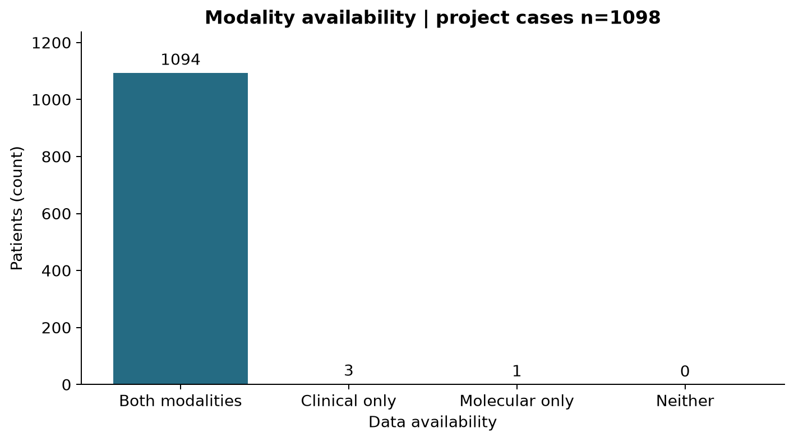
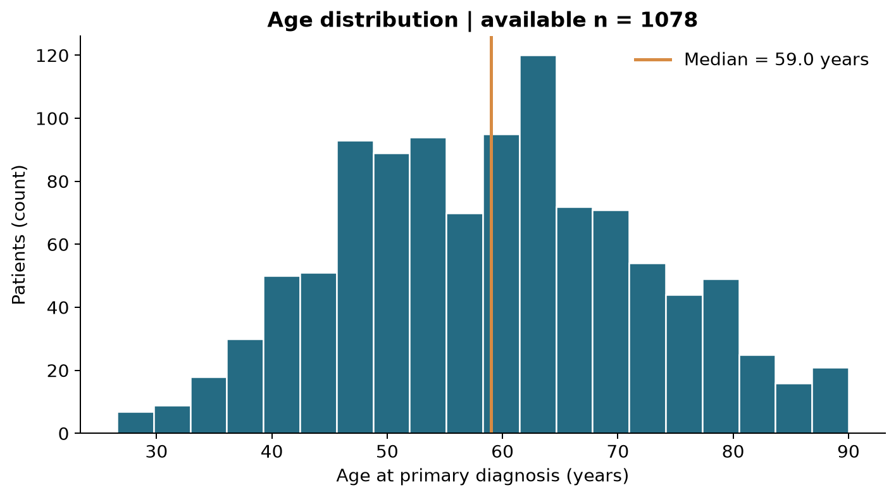
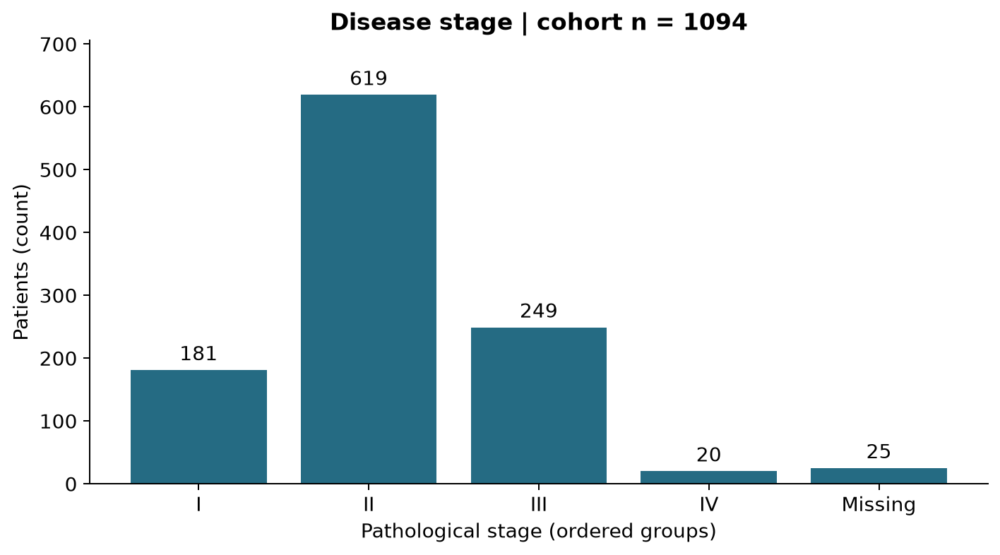
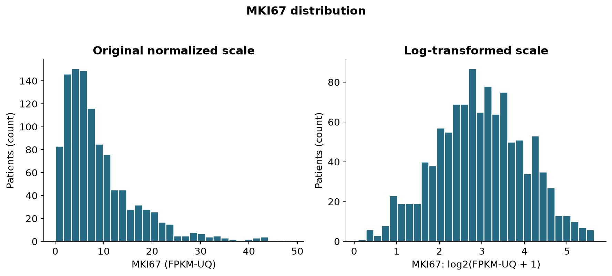
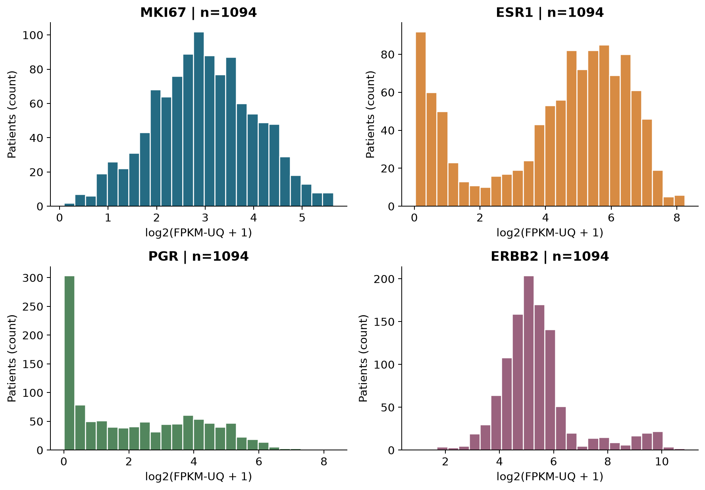
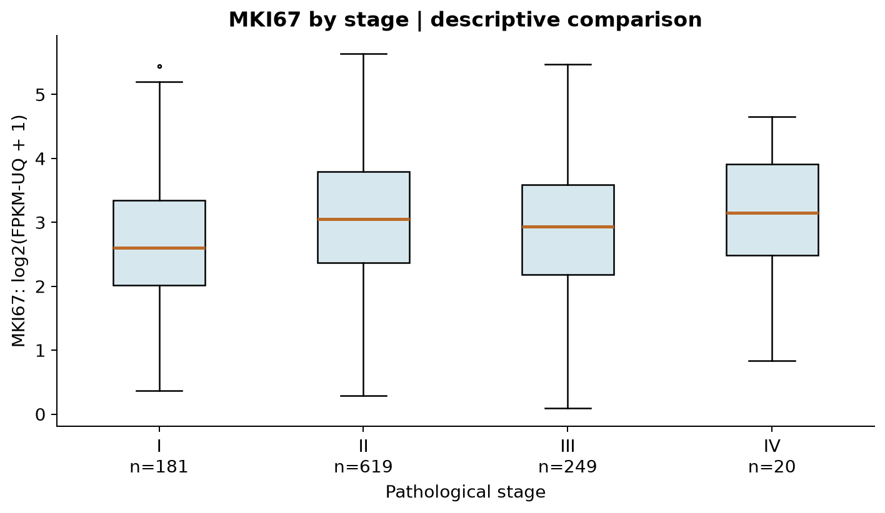
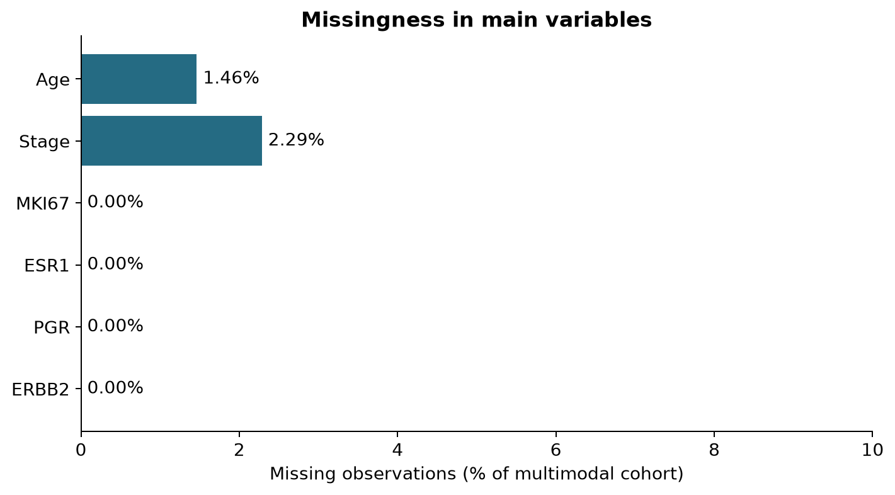

# گزارش فاز اول - TCGA-BRCA

پروژهٔ درس آمار | پاییز ۱۴۰۵

فاز اول: شناخت داده و آمار توصیفی

مسیر ب: TCGA-BRCA | اطلاعات بالینی و بیان ژن RNA-seq

موضوع: توصیف ویژگی‌های بالینی و بیان ژن‌های منتخب در بیماران سرطان پستان

سؤال اصلی پروژه: بیان MKI67 با سن هنگام تشخیص، مرحلهٔ بیماری و بیان ESR1، PGR و ERBB2 چه ارتباطی دارد؟ این گزارش، بخش توصیفیِ لازم برای بررسی این سؤال را فراهم می‌کند.

مقدار | شاخص

1098 | بیماران ثبت‌شده در پروژه

1094 | بیماران دارای هر دو نوع داده، پس از انتخاب یک نمونه برای هر بیمار

1054 | بیماران دارای همهٔ متغیرهای اصلی بدون گمشدگی

59.03 | میانهٔ سن هنگام تشخیص، سال

7 | تعداد شکل‌های توصیفی

24 | تطبیق عددی موفق بیان ژن با فایل اصلی در موارد کنترل

دامنهٔ این تحویل

فقط فاز اول اجرا شده است: منشأ داده، واحد مشاهده، قابلیت تعمیم، طبقه‌بندی متغیرها، کنترل کیفیت، جدول‌های فراوانی، مرکز و پراکندگی، مصورسازی و مقایسهٔ توصیفی. هیچ آزمون فرض، مقدار p، برازش رگرسیون یا ادعای علیت در این گزارش وجود ندارد.

منبع: داده‌های عمومی GDC؛ فقط نمونه‌های تومور اولیه در جدول مولکولی اصلی وارد شده‌اند. مقدار صفرِ بیان ژن معتبر است و نقاط دورافتاده صرفاً به‌دلیل بزرگی حذف نشده‌اند.

دریافت به وقت تهران در روز 2 از ماه 11 سال 2026، ساعت 17:26. نسخهٔ منبع: Data Release 46.0 - August 10, 2026.

۱. منشأ داده، طراحی مطالعه و متغیرها

TCGA برنامهٔ مشترک NCI و NHGRI است که از سال ۲۰۰۶ آغاز شد و طی ۱۲ سال داده‌های مولکولی و بالینی انواع سرطان را گردآوری کرد [۱]. داده‌های این پروژه از بخش عمومی TCGA-BRCA در GDC دریافت شده‌اند. نسخهٔ انتشار و تاریخ دریافت با زمان تشخیص یا نمونه‌گیری یکسان نیستند.

در تشخیص‌های اصلیِ دارای سال معتبر، سال تشخیص از 1988 تا 2013 است؛ برای 1094 بیمار این مقدار موجود است. این بازه، بازهٔ سال تشخیص است و نباید به‌جای دورهٔ جمع‌آوری همهٔ نمونه‌ها گزارش شود. تاریخ تقویمی دقیق جمع‌آوری همهٔ نمونه‌ها در استخراج مورد استفاده موجود نیست.

این کار تحلیل ثانویهٔ مشاهده‌ای از پرونده‌های بالینی و اندازه‌گیری‌های مولکولی است. افراد به‌صورت تصادفی برای مداخله تخصیص نیافته‌اند و نمونه، پیمایش تصادفی از جمعیت عمومی نیست. در دسترس‌بودن بافت و دادهٔ باکیفیت می‌تواند ترکیب نمونه را تغییر دهد؛ بنابراین تعمیم به همهٔ بیماران سرطان پستان، به‌خصوص جمعیت ایران، محدود است.

واحد و نقش | نوع | متغیر

کلید اتصال؛ بدون خلاصهٔ عددی | اسمی، شناسه | case UUID / بارکد بیمار

سال؛ توضیحی | کمی پیوسته | سن هنگام تشخیص

I تا IV؛ توضیحی و گروه‌بندی | ترتیبی | مرحلهٔ پاتولوژیک

FPKM-UQ؛ پاسخ | کمی پیوسته | بیان MKI67

FPKM-UQ؛ توضیحی مولکولی | کمی پیوسته | بیان ESR1، PGR، ERBB2

برچسب منبع؛ توصیف نمونه | اسمی | جنس ثبت‌شده

بیان ژن با روش STAR - Counts و نرمال‌سازی FPKM-UQ استفاده شده است [۲،۳]. برای نمایش، تبدیل log2(FPKM-UQ + 1) محاسبه شده؛ تبدیل روی مقدار نرمال‌شده است، نه شمارش خام. بیان RNA با نتیجهٔ آزمایش پروتئینی گیرنده‌ها یکسان فرض نمی‌شود.

انتخاب محدود چهار ژن پیش از محاسبهٔ نتایج ثبت شد. این ژن‌ها در پژوهش‌های بیان نشانگرهای سرطان پستان بررسی شده‌اند [۵]؛ مطالعهٔ حاضر هیچ آستانهٔ تشخیصی یا ادعای بالینی از آن‌ها استخراج نمی‌کند.

۲. ساختار داده و اتصال در سطح بیمار

ساختار داده سلسله‌مراتبی است: بیمار ← نمونهٔ بافتی ← aliquot ← فایل اندازه‌گیری. یک بیمار می‌تواند چند تشخیص بالینی یا چند فایل RNA داشته باشد. کلید اتصال case UUID است و تطابق بارکد نمونه با بارکد بیمار نیز کنترل شده است [۴].

تعداد | مرحله

1098 | رکورد بیمار در پروژه

1097 | بیماران دارای رکورد بالینی/جمعیت‌شناختی

1342 | رکوردهای تشخیص، پیش از انتخاب تشخیص اصلی

1096 | بیماران دارای تشخیص اصلی یکتا

1231 | فایل‌های RNA عمومی، همهٔ انواع بافت

1111 | فایل‌های تومور اولیه، پیش از انتخاب یک فایل

120 | فایل‌های بافت طبیعی/متاستاتیک کنارگذاشته‌شده

16 | فایل‌های تومور اولیهٔ اضافی کنارگذاشته‌شده

1095 | بیماران یکتای مولکولی پس از انتخاب

1094 | بیماران جدول اصلی دارای هر دو وجه

1054 | بیماران کامل در همهٔ متغیرهای اصلی

نمونهٔ انتخابی باید Primary Tumor باشد؛ در صورت چند نمونه، کمترین بارکد نمونه، سپس بارکد aliquot و سپس UUID فایل انتخاب شد. این قاعده ثابت و مستقل از نتایج است و برتری کیفی نمونه را ادعا نمی‌کند. همهٔ کنارگذاری‌ها در sample_file_audit.csv و انتخاب‌ها در selected_files.csv ثبت شده‌اند.

شکل 6. الگوی دسترسی به انواع داده. دادهٔ بالینی به معنی وجود رکورد تشخیص یا جمعیت‌شناختی است؛ وجود رکورد به معنی کامل‌بودن همهٔ متغیرها نیست. دادهٔ مولکولی به نمونهٔ تومور اولیهٔ واجد شرایط اشاره دارد.

۳. توصیف و ممیزی بخش بالینی

از 1097 بیمار دارای رکورد بالینی، 1096 بیمار تشخیص اصلی یکتا دارند. فقط همان تشخیص برای سن و مرحله استفاده شد؛ تشخیص قبلی جایگزین تشخیص اصلی نشد. وجود رکورد بالینی به معنی کامل‌بودن همهٔ فیلدها نیست.

در نمونهٔ دارای هر دو وجه، سن برای 1078 نفر موجود است: میانگین 59.10، میانه 59.03 و انحراف معیار 13.15 سال؛ چارک اول 49.36، چارک سوم 68.09 و IQR برابر 18.73 سال است. دامنه از 26.57 تا 90.00 سال است.

شکل 1. توزیع سن هنگام تشخیص. سن از تشخیص اصلی استخراج و از روز به سال تبدیل شده است. خط عمودی میانه را نشان می‌دهد؛ داده‌های گمشده در هیستوگرام وارد نمی‌شوند.

شکل 2. فراوانی مرحلهٔ بیماری. زیرمرحله‌های معتبر در چهار مرحلهٔ اصلی ادغام شده‌اند. ستون Missing نیز نمایش داده شده تا مخرج درصدها و نبود داده روشن بماند.

برای سن، میانگین و انحراف معیار خلاصهٔ عمومی‌اند و میانه و IQR نسبت به مقادیر انتهایی مقاوم‌ترند. برای مرحلهٔ ترتیبی، فراوانی و درصد گزارش می‌شود؛ میانگین شمارهٔ مراحل محاسبه نشده است. مخرج درصد مرحله، کل نمونهٔ دارای هر دو وجه است و گمشده‌ها جدا ثبت شده‌اند.

۴. ممیزی مستقل بخش مولکولی

پس از انتخاب یک نمونهٔ تومور اولیه برای هر بیمار، بیان چهار ژن استخراج شد. برای بیمار دارای تنها یک فایل RNA، خروجی سطح بیمارِ رابط GDC بدون ابهام نمونه استفاده شد. برای بیمار دارای چند فایل، مقادیر مستقیماً از فایل تومور منتخب خوانده شد؛ خروجی سطح بیمار به نمونهٔ دلخواه نسبت داده نشد.

شش فایل تک‌نمونه‌ای به‌صورت ثابت برای کنترل مستقیم انتخاب شدند؛ 24 مقدار ژن با خروجی رابط تطبیق یافت. فایل‌های مستقیم با MD5 رسمی کنترل شدند و تطابق شناسهٔ ژن با نام ژن بررسی شد. جدول و جزئیات کنترل در expression_validation.csv آمده است.

بیشینه | کمینه | IQR | میانه | گمشده | موجود | ژن

48.87 | 0.06 | 8.04 | 6.70 | 0 | 1094 | MKI67

300.70 | 0.02 | 56.99 | 27.90 | 0 | 1094 | ESR1

311.42 | 0.00 | 13.45 | 2.56 | 0 | 1094 | PGR

1,835.33 | 0.85 | 32.13 | 34.64 | 0 | 1094 | ERBB2

واحد جدول بالا FPKM-UQ است. تعداد موجود و گمشده به نمونهٔ اصلی دارای هر دو نوع داده مربوط‌اند؛ خلاصه‌های مستقل قبل از اتصال نیز در descriptive_statistics.csv ثبت شده‌اند.

شکل 3. توزیع بیان MKI67 در دو مقیاس. نمایش هم‌زمان مقیاس اصلی و تبدیل لگاریتمی، اثر چولگی و مقادیر بزرگ را آشکار می‌کند. تبدیل لگاریتمی آزمون نرمال‌بودن یا تضمین نرمال‌بودن نیست.

تفاوت شکل توزیع روی دو مقیاس، دلیل گزارش هم‌زمان مقیاس اصلی و لگاریتمی است. برای توزیع دارای دنبالهٔ بلند، میانه و IQR معمولاً تفسیر مقاوم‌تری دارند؛ میانگین، انحراف معیار و چارک‌ها نیز برای شفافیت در جدول‌های همراه گزارش شده‌اند.

۵. توزیع ژن‌ها و نقاط دورافتاده

شکل 5. توزیع چهار ژن منتخب. همهٔ ژن‌ها پیش از محاسبهٔ نتایج انتخاب شده‌اند. هر پنل توزیع یک ژن را در همان مقیاس مشخص نشان می‌دهد و هیچ آزمون انتخاب ویژگی اجرا نشده است.

خارج از حصار IQR | IQR | انحراف معیار | میانه | میانگین | ژن

1 | 1.41 | 1.05 | 2.94 | 2.97 | MKI67

0 | 3.36 | 2.27 | 4.85 | 4.24 | ESR1

0 | 3.59 | 1.94 | 1.83 | 2.22 | PGR

106 | 1.25 | 1.45 | 5.16 | 5.38 | ERBB2

واحد همهٔ خلاصه‌های این جدول log2(FPKM-UQ + 1) است. چارک‌ها با روش درون‌یابی خطی و انحراف معیار نمونه‌ای با مخرج n−1 محاسبه شده‌اند. دورافتاده به معنی خارج‌بودن از بازهٔ Q1−1.5×IQR تا Q3+1.5×IQR است و معادل خطای اندازه‌گیری نیست.

هیچ مشاهده‌ای صرفاً به‌دلیل قرارگرفتن بیرون حصار IQR حذف نشده است. این پرچم فقط برای بررسی توزیع استفاده می‌شود. توزیع ژن‌ها، مقیاس‌های متفاوت و نسبت مقادیر انتهایی نشان می‌دهند که مقایسهٔ مستقیم ارتفاع بیان بین ژن‌های مختلف نیاز به احتیاط دارد؛ سؤال فعلی بر توزیع هر ژن و ارتباط آن در میان بیماران متمرکز است.

۶. مقایسهٔ توصیفی MKI67 بین مراحل بیماری

IQR | میانه | میانگین | بیان موجود | اندازهٔ گروه | مرحله

1.33 | 2.61 | 2.71 | 181 | 181 | I

1.43 | 3.05 | 3.07 | 619 | 619 | II

1.40 | 2.94 | 2.90 | 249 | 249 | III

1.43 | 3.15 | 3.03 | 20 | 20 | IV

مقیاس جدول log2(FPKM-UQ + 1) است. بیمارِ فاقد مرحلهٔ معتبر فقط از این مقایسه کنار گذاشته می‌شود؛ در خلاصهٔ بیان ژنِ کل نمونه باقی می‌ماند. این تفکیک مانع حذف سراسری و پنهان افراد دارای یک فیلد گمشده می‌شود.

شکل 4. مقایسهٔ توصیفی MKI67 میان مراحل بیماری. خط وسط میانه، جعبه فاصلهٔ چارک اول تا سوم و نقاط بیرونی مقادیر خارج از حصار ۱٫۵ برابر IQR را نشان می‌دهند. این نقاط حذف نشده‌اند؛ اندازهٔ هر گروه زیر محور آمده است.

در این نمونه، بیشترین میانه در مرحلهٔ IV با مقدار 3.15 و کمترین میانه در مرحلهٔ I با مقدار 2.61 دیده می‌شود. این مقایسه صرفاً توصیف نمونه است؛ هم‌پوشانی توزیع‌ها و اندازهٔ نامتوازن گروه‌ها باید در تفسیر در نظر گرفته شود.

کوچک‌ترین گروه، مرحلهٔ IV با 20 بیمار دارای بیان موجود است. پایداری خلاصهٔ این گروه از گروه‌های بزرگ‌تر کمتر قابل اتکاست. هیچ آزمون معناداری یا برآورد اثر تعدیل‌شده در این فاز اجرا نشده است.

۷. گمشدگی و انتخاب نمونهٔ دارای هر دو وجه

از کل بیماران پروژه، 3 نفر فقط وجه بالینی، 1 نفر فقط وجه مولکولی و 0 نفر هیچ‌یک از دو وجه واجد شرایط را ندارند؛ 1094 نفر دارای هر دو وجه‌اند. نبود یک وجه با گمشدگی یک متغیر داخل وجه موجود متفاوت است.

میانهٔ سن | سن موجود | تعداد | گروه

59.03 | 1078 | 1094 | هر دو وجه

49.39 | 3 | 3 | فقط بالینی

- | 0 | 1 | فقط مولکولی

- | 0 | 0 | هیچ‌کدام

توزیع مرحله و جنس نیز به تفکیک «هر دو وجه» و «فقط بالینی» در clinical_selection_comparison.csv گزارش شده است. چون گروه فاقد RNA بسیار کوچک است، حتی تفاوت ظاهری درصدها شواهد قوی برای نبود یا وجود سوگیری انتخاب نیست؛ آزمون آماری روی آن انجام نشده است.

برای نمونه، مرحلهٔ II در گروه دارای هر دو وجه 619 نفر (56.58 درصد) و در گروه فقط بالینی 2 نفر از 3 نفر است. نسبت جنس ثبت‌شدهٔ female به‌ترتیب 98.90 و 100.00 درصد است. این‌ها تفاوت‌های توصیفی‌اند.

شکل 7. درصد گمشدگی متغیرهای اصلی. مخرج همهٔ درصدهای این شکل، تعداد بیماران دارای هر دو نوع داده است. گمشدگی متغیر با نبود کل یک نوع داده یکسان نیست.

از 1094 بیمار دارای هر دو نوع داده، 1054 بیمار همهٔ متغیرهای اصلی را بدون گمشدگی دارند. در این فاز خلاصهٔ هر متغیر با دادهٔ موجود همان متغیر محاسبه می‌شود و مخرج آن صریح است. جایگذاری مقدار گمشده انجام نشده و تعداد نمونهٔ کامل جدا گزارش شده است.

در دادهٔ اصلی، 17 بیمار دارای پرچم مبهم‌سازی سن هستند. سن دقیق این افراد از دادهٔ عمومی قابل بازیابی نیست؛ خلاصه‌ها سن ثبت‌شده را توصیف می‌کنند. پرچم مربوط در جدول پردازش‌شده نگه داشته شده است.

۸. تصمیم‌های کیفیت داده و دامنهٔ ادعا

تصمیم | مورد بررسی

نامشخص و گزارش‌نشده گمشده هستند؛ مقدار اصلی نیز حفظ می‌شود. | مرحلهٔ نامشخص

فقط تشخیص اصلی یکتا؛ عدم ترکیب فیلدهای تشخیص‌های متفاوت. | چند تشخیص برای یک بیمار

انتخاب ثابت یک فایل تومور اولیه؛ ثبت همهٔ کنارگذاری‌ها. | چند نمونه یا فایل

اعتبار در محدودهٔ صفر تا ۱۲۰ سال؛ مقدار ناممکن به گمشده تبدیل و ثبت می‌شود. | سن و واحد آن

صفر معتبر است؛ مقدار منفی یا نامتناهی نامعتبر است. | مقدار بیان ژن

پرچم‌گذاری با حصار IQR؛ حذف خودکار انجام نمی‌شود. | مقادیر دورافتاده

گزارش تعداد موجود هر متغیر؛ بدون جایگذاری. | گمشدگی متغیرها

تعداد مواردی که به‌عنوان مقدار نامعتبر یا مرحلهٔ ناشناخته نیازمند اقدام در quality_issues.csv ثبت شدند: 0. نبود اطلاعات به‌خودی‌خود در این شمارش، مقدار نامعتبر محسوب نشده است؛ گمشدگی در جدول‌های مخصوص گزارش می‌شود.

محدودیت‌ها

این نمونه، انتخابی و مشاهده‌ای است. وجود بافت مناسب و پوشش داده‌ها، ناهمگنی مراکز و پردازش‌ها، تفاوت ترکیب سلولی تومور، تفاوت ویرایش‌های مرحله‌بندی و نبود اطلاعات برخی بیماران می‌تواند خلاصه‌ها را تحت تأثیر قرار دهد. قاعدهٔ انتخاب نمونه قابل تکرار است اما انتخاب زیستی یگانه‌ای نیست. در این فاز اصلاح اثر مرکز/دستهٔ آزمایش و تحلیل حساسیت اجرا نشده‌اند.

داشتن هر دو وجه به معنی کامل‌بودن همهٔ متغیرها نیست. داده‌ها رابطهٔ علّی یا اعتبار تشخیصی ژن‌ها را ثابت نمی‌کنند. حتی اگر در فازهای بعد نتیجه‌ای معنادار نشود، درستی روش و گزارش محدودیت‌ها مستقل از آن اهمیت دارد.

سؤال تثبیت‌شده پس از شناخت داده

در بیماران TCGA-BRCA دارای نمونهٔ تومور اولیهٔ RNA-seq و اطلاعات بالینی، بیان MKI67 چگونه توزیع شده و از نظر توصیفی میان مراحل پاتولوژیک بیماری چه تفاوتی دارد؟ بررسی ارتباط رسمی آن با سن و سایر ژن‌های از پیش انتخاب‌شده، ادامهٔ سؤال پروژه برای فازهای بعد خواهد بود.

دادهٔ حاضر برای بخش توصیفی سؤال مناسب است، چون اندازه‌گیری کمی بیان ژن، سن و گروه‌بندی مرحله در سطح بیمار قابل اتصال‌اند. ناقص‌بودن مرحله در برخی افراد و کوچک‌بودن بعضی گروه‌ها محدودیت این تناسب است.

۹. بازتولید، فایل‌های همراه و منابع

ترتیب بازسازی: ابتدا وابستگی‌های requirements.txt نصب می‌شوند؛ سپس src/fetch_data.py داده‌های عمومی را دریافت می‌کند، src/analyze_phase1.py جدول‌ها و شکل‌ها را می‌سازد و src/build_report.py همین گزارش را از نتایج محاسبه‌شده تولید می‌کند. نتایج عددی به‌صورت دستی در گزارش وارد نشده‌اند.

فایل‌های خام در data/raw نگه داشته می‌شوند و در GitHub یا بستهٔ تحویل قرار نمی‌گیرند. پروندهٔ provenance.json نسخه و تاریخ دریافت، source_fingerprints.csv اثر انگشت فایل‌های خام و selected_files.csv شناسه و MD5 منبع را ثبت می‌کنند. یکسان‌بودن نسخهٔ انتشار و اثر انگشت فایل‌ها برای بازتولید دقیق مهم است.

محتوا | فایل همراه

جریان نمونه و تعدادها | data_flow.csv

تصمیم برای تمام فایل‌ها و تشخیص‌ها | sample_file_audit.csv / diagnosis_audit.csv

خلاصهٔ کمی قبل و بعد از اتصال | descriptive_statistics.csv

فراوانی طبقه‌ها و مقایسهٔ گروه‌ها | categorical_frequencies.csv / mki67_by_stage.csv

الگوی وجود داده و مقایسهٔ نمونه‌ها | modality_availability.csv / clinical_selection_comparison.csv

کنترل عددی و مقادیر نامعتبر | expression_validation.csv / quality_issues.csv

منابع

- [[1] NCI - The Cancer Genome Atlas](https://www.cancer.gov/ccg/research/genome-sequencing/tcga)

- [[2] GDC - mRNA Analysis Pipeline](https://docs.gdc.cancer.gov/Data/Bioinformatics_Pipelines/Expression_mRNA_Pipeline/)

- [[3] GDC API - Gene Expression Values](https://docs.gdc.cancer.gov/API/Users_Guide/Data_Analysis/)

- [[4] GDC - TCGA Barcode](https://docs.gdc.cancer.gov/Encyclopedia/pages/TCGA_Barcode/)

- [[5] ESR1, PGR, ERBB2 and MKI67 mRNA study (2025)](https://pubmed.ncbi.nlm.nih.gov/40666735/)

- [TCGA-BRCA project and public data](https://portal.gdc.cancer.gov/projects/TCGA-BRCA)

قدردانی: این نتایج بر داده‌های تولیدشده توسط شبکهٔ پژوهشی TCGA متکی‌اند. از اهداکنندگان نمونه و گروه‌های گردآورندهٔ داده قدردانی می‌شود.

شفافیت آماده‌سازی: کد، محاسبات و پیش‌نویس گزارش با کمک دستیار هوش مصنوعی آماده شده‌اند؛ بازبینی علمی و توانایی توضیح و دفاع از تصمیم‌ها بر عهدهٔ دانشجو است.
